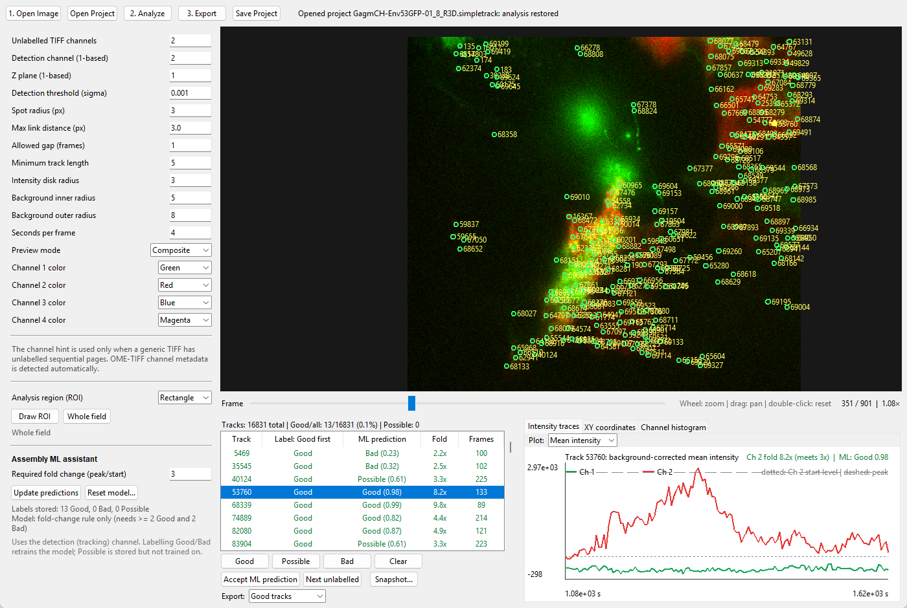
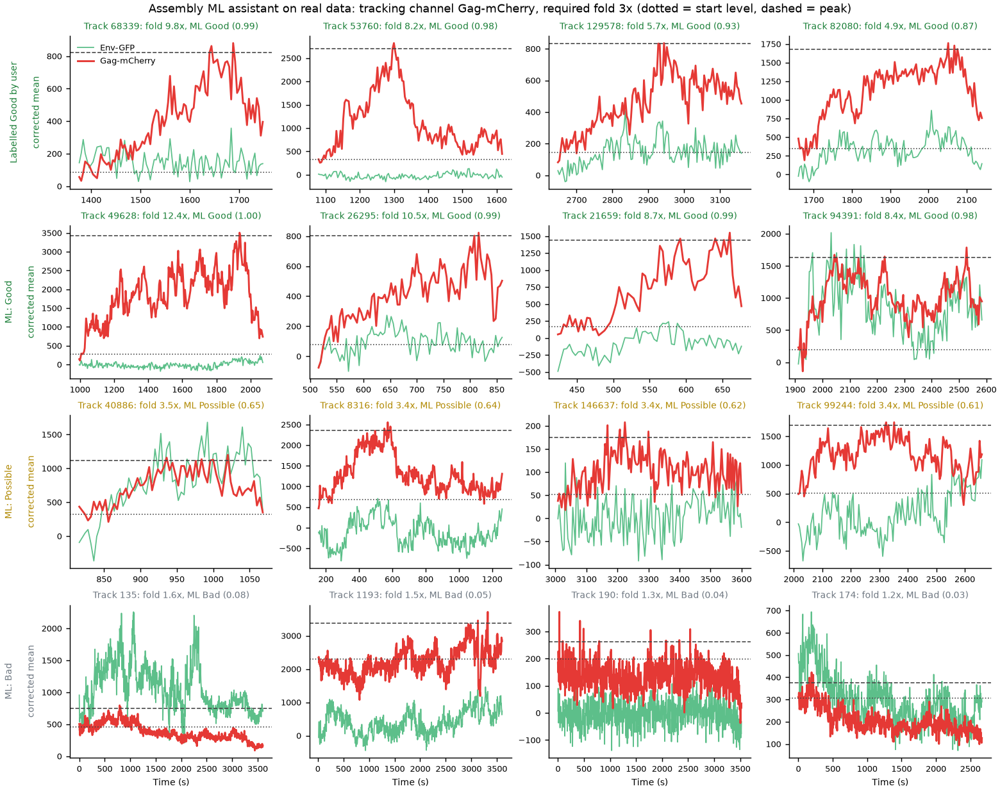
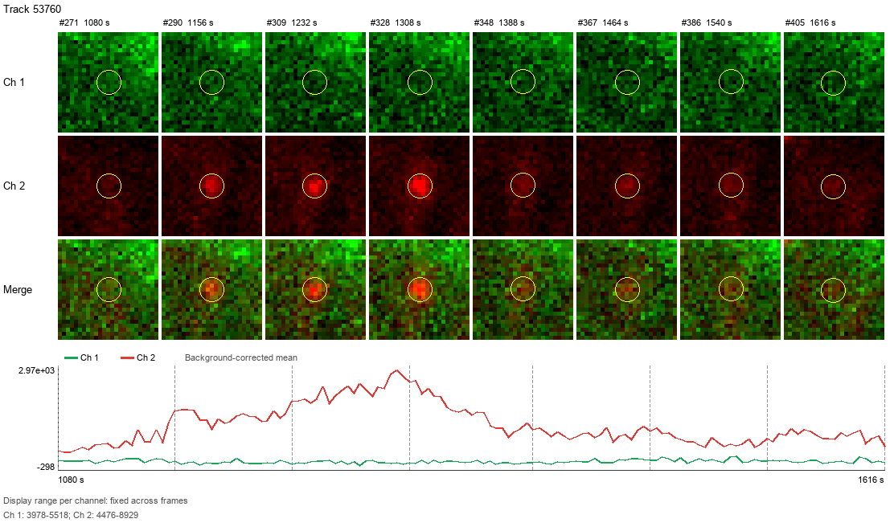
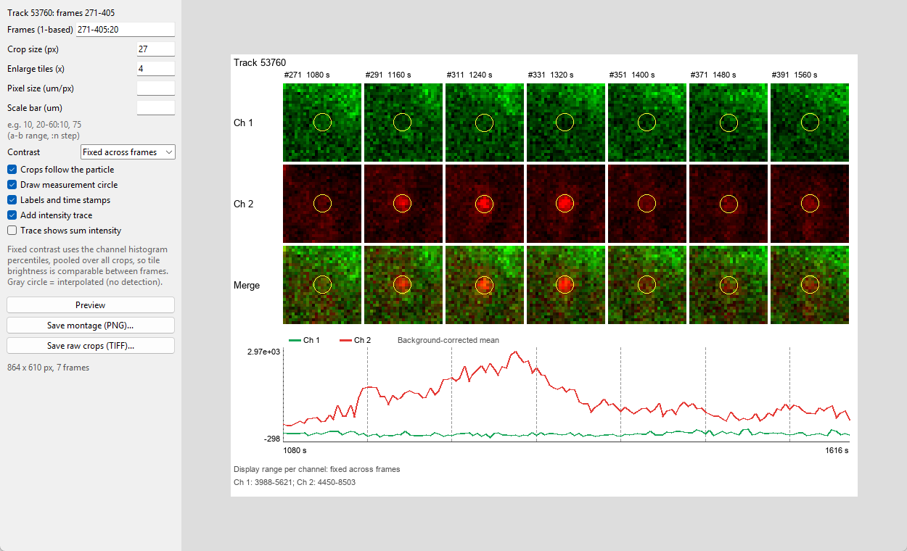
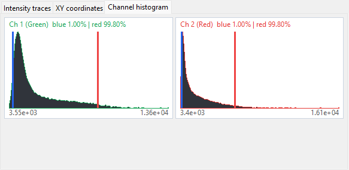
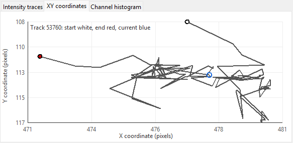

# Single-particle tracking for HIV assembly: SimpleTrack ML

**A Windows app that tracks fluorescent puncta in multi-channel live-cell movies, measures every channel along each track, and uses a small machine-learning assistant to flag assembly events.**

SimpleTrack opens 1-4 channel TIFF / OME-TIFF and DeltaVision `.dv` time series. It detects puncta in one channel, links them through time, and measures the background-corrected intensity of every channel at each tracked position. You can review tracks, label them, make figures, and export the results to Excel or CSV. The **assembly ML assistant** predicts whether each track is an assembly event and learns from your Good / Bad labels as you work.

*Main window: Env-GFP (green) and Gag-mCherry (red) imaged every 4 s on a DeltaVision microscope, 901 frames, tracked in the Gag channel. Track 53760 is selected. Its trajectory is drawn on the movie, and its intensity traces are shown below the movie. The track list shows the user label, the ML prediction with its probability, and the fold change.*

## Download

| Version | What it is | Download |
|---|---|---|
| **1.1: ML version (recommended)** | Everything in the first version, plus the assembly ML assistant, the **Possible** label, and ML columns in the export. | `SimpleTrack-ML-windows.zip` from [release v1.1.0](../../releases/latest) |
| **1.0: first version** | Detection, tracking, multi-channel intensity measurement, manual Good/Bad labelling, snapshot montages, export. No ML. | `SimpleTrack-windows.zip` from release v1.0.0 on the [Releases](../../releases) page |

Both versions read and write the same `.simpletrack` project files.

### Install and run (Windows 10/11, no Python needed)

1. Download the zip from the [Releases](../../releases) page.
2. Unzip it anywhere, open the `SimpleTrack` folder, and double-click `SimpleTrack.exe`. Keep the `.exe` inside its folder; it needs the `_internal` folder next to it.
3. The first time, Windows SmartScreen may say the app is unrecognised. Choose **More info → Run anyway**.

## What it does

### 1. Detect, track, and measure every channel

- Puncta are detected in the chosen **detection channel** with a robust noise threshold, then linked frame to frame (max link distance, allowed gap, minimum track length).
- At every tracked position, each channel is measured as a disk mean and sum, minus the median of a local background annulus.
- You can restrict the analysis to a rectangular or freehand **ROI**.
- Large movies are memory-mapped, and compressed TIFFs (LZW and others) are supported.

### 2. Assembly ML assistant

*Real traces from the same movie. Top row: tracks the user labelled Good. Lower rows: long unlabelled tracks the assistant predicted Good, Possible, or Bad. Dotted line = start level, dashed line = peak. The thick line is the tracking channel (Gag-mCherry).*

- **Fold-change rule.** An assembly event must rise about **3-fold** (adjustable) from the start of the track to its peak in the tracking channel. The peak is taken from a 3-frame median-smoothed trace. The start level is the median of the first 15% of points (2-5 points), floored at the trace noise.
- **Learns from your labels.** Each time you label a track **Good** or **Bad**, the assistant retrains. Once it has at least 2 of each, a class-balanced logistic regression uses 10 trace features: fold change, rise SNR, time to peak, retention after the peak, rise monotonicity, trend, largest step, track length, detection confidence, and mobility. With few labels it stays close to the fold rule. The panel shows a cross-validated accuracy.
- **The fold requirement is enforced.** A track below the required fold is never predicted Good; at most it is Possible.
- **Possible** marks unclear events. These are stored but not used for training.
- **Fast review.** **Accept ML prediction** applies the prediction to the selected tracks. **Next unlabelled** jumps to the next track to review.
- **Keeps learning across movies.** Labelled examples are stored in `%USERPROFILE%\.simpletrack\assembly_model.json`. **Reset model…** clears it.

### 3. Publication-ready track montages

*Select a track and click **Snapshot…**. You get one row per channel plus a Merge row, crops that follow the particle, and the intensity trace with the chosen frames marked. Each channel uses one display range across all frames, so tile brightness can be compared between frames.*

**Save montage (PNG)** writes the figure. **Save raw crops (TIFF)** writes the unscaled pixels as an ImageJ T,C,Y,X hyperstack for Fiji.

### 4. Per-channel contrast and trajectory views

 

Drag the blue (black level) or red (white level) marker on each channel histogram to change the display contrast. This never changes the measurements. The XY tab plots the selected track on equal axes with start, end, and current-frame markers.

## Typical workflow

1. **Open Image**: a TIFF, OME-TIFF, or DV movie. For a plain TIFF without channel metadata, enter the channel count first.
2. Set channel colours, the detection channel, and the detection/tracking parameters. Optionally draw an ROI.
3. **Analyze**.
4. Review tracks. Label them **Good / Possible / Bad**, or accept the ML prediction. Sort the list by label, prediction, fold, or length.
5. **Snapshot…** to make figures of individual tracks.
6. **Export** all, selected, Good, Possible, or Good + Possible tracks to Excel or CSV.
7. **Save Project** to resume later without re-analysing. The project references the movie rather than copying it. If the movie has moved, SimpleTrack asks you to locate it.

See the [user guide](docs/user_guide.md) for every parameter, the export columns, and image-dimension handling.

## Output

Excel export has three sheets:

- `measurements`: one row per tracked time point (time, XY, and every channel's raw and background-corrected mean and sum, plus changes from the previous and first detection).
- `track_summary`: one row per track.
- `settings`: every parameter, the ROI, and the input file.

The ML version adds `user_label`, `ml_prediction`, `ml_probability`, `fold_change`, and `meets_fold_threshold` columns.

## Questions and feedback

Please open an [issue](../../issues) for bug reports, questions, or feature requests.

## Citation

If SimpleTrack helps your research, please cite this repository.
